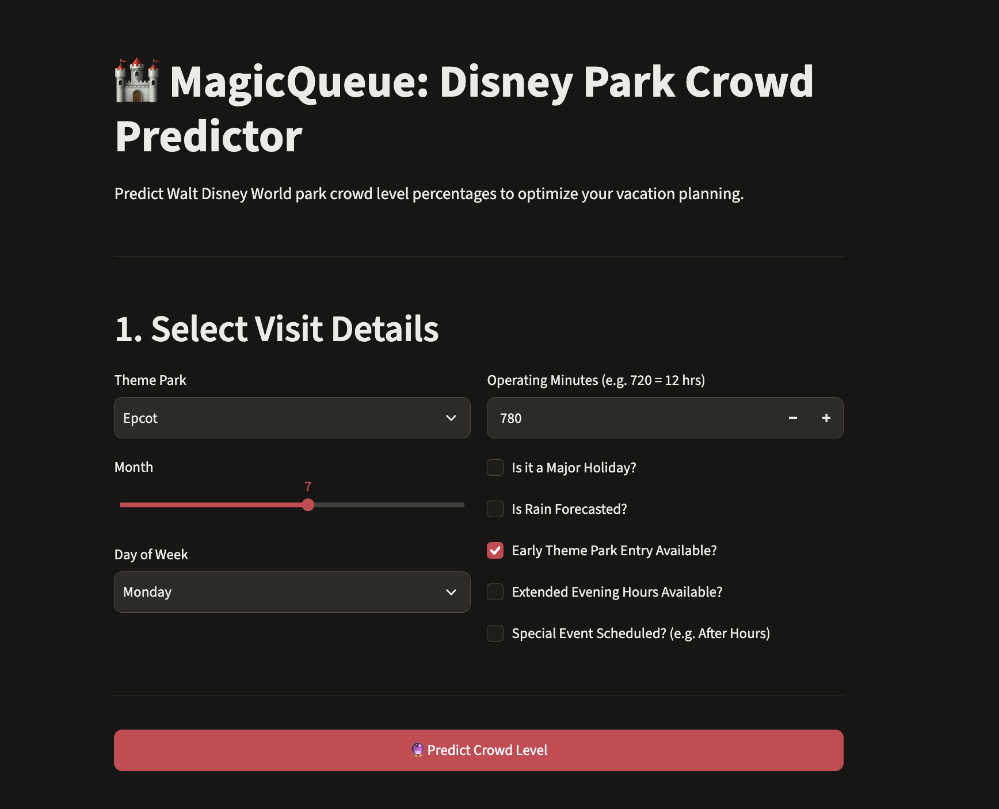
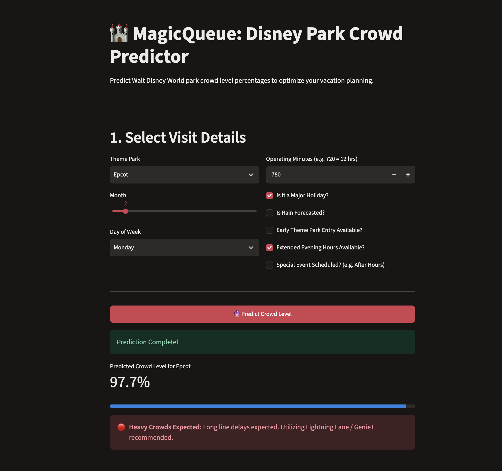
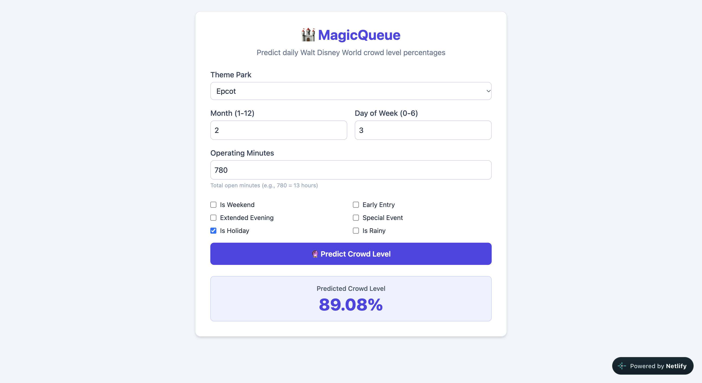

# MagicQueue

Walt Disney Castle, 2019. Photo credit: Annaliese Tech

## Problem Statement
I, along with millions of other Disney fanatics, spend hundreds, if not thousands of dollars, to experience Walt Disney World theme parks. However, the rides, although a couple of minutes long, can have lengthy wait times. The issue is that the ride times do not meet the high guest population; therefore, we can predict the optimized time as to when to go. The solution is to create a machine learning pipeline and API web service to predict daily park crowd levels (%) based on the following features: operating hours, holidays, weekends, and weather. Optimize park itineraries. I will achieve this though EDA, model training, reproductibility, model deployment, dependency and environment management, containerization, and cloud deployment.

## 📊 Data Source & Instructions
The dataset used for this project is the **Walt Disney World Wait Times** dataset (sourced from [Kaggle](https://www.kaggle.com/datasets/chadwambles/walt-disney-world-wait-times?resource=download)). 

* **Committed Files:** The cleaned and enriched files (`calendar_enriched.csv` and `ride_stats.csv`) are included directly in the repository under the `data/` folder.
* **Alternative Download:** If you wish to pull fresh data manually, you can download the raw data from Kaggle and place `calendar_enriched.csv` and `ride_stats.csv` into the `data/` directory.

## Project Structure
- `notebook.ipynb`: Jupyter notebook containing data prep, extensive EDA, feature importance, and model experimentation.
- `train.py`: Standalone script to train the final XGBoost model and save it to `model.bin`.
- `predict.py`: FastAPI web service to serve model predictions.
- `app.py`: Streamlit frontend interface for user interaction.
- `Dockerfile`: Container configuration to run the service.
- `requirements.txt`: Python package dependencies.
- `data/`: Contains `calendar_enriched.csv` and `ride_stats.csv`.

# EDA
•Average crowd level by park name

•Crowd level by holidays

•Crowd level by rain

•Correlation Heatmap

•Quick feature importance with Random Forest

# Model Training
1. Baseline (Ridge Regression)
2. Random Forest (tuning n_estimators and max_depth)
3. XGBoost (Tuning learning_rate and max_depth)

# Exporting Notebook to Script
### 1. Clone the Repository
```bash
git clone [https://github.com/your-username/magicqueue-wait-predictor.git](https://github.com/your-username/magicqueue-wait-predictor.git)
cd magicqueue-wait-predictor
```

# Reproductibility

### Train the Model
```bash
python train.py
```

# Model Deployment
### Run FastAPI/Prediction API
```bash
uvicorn predict:app --reload --port 8000
```

### Run Streamlit Frontend UI
```bash
streamlit run app.py
```

# Dependency and Environment Management
### Install Dependencies
```bash
pip install -r requirements.txt
```

# Containerization
### Run Docker
```bash
docker build -t magicqueue-api .
```
```bash
docker run -p 8000:8000 magicqueue-api
```

# Cloud Deployment
## The MagicQueue Disney Park Crowd Predictor

## Test Success Case Example


## Loom Demonstration
Backend Video Demo: https://www.loom.com/share/01dc6e838026404aa67d1c6d0b6cabbe

## Netlify Website

Webiste Link: https://disneyqueue.netlify.app/


# Conclusion
Model Summary: After experimenting with Ridge Regression, Random Forest, and XGBoost in notebook.ipynb, XGBoost achieved the best performance metrics (lowest RMSE and MAE on validation sets) and was selected as the final production model.
